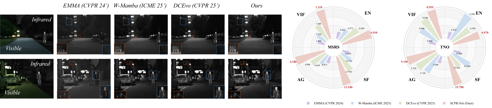
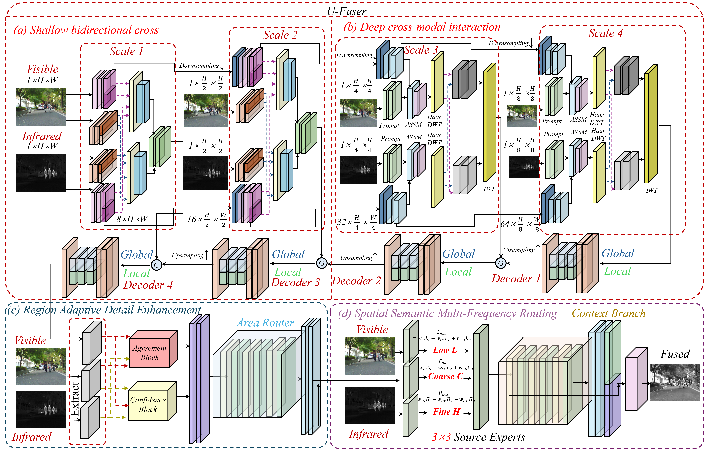
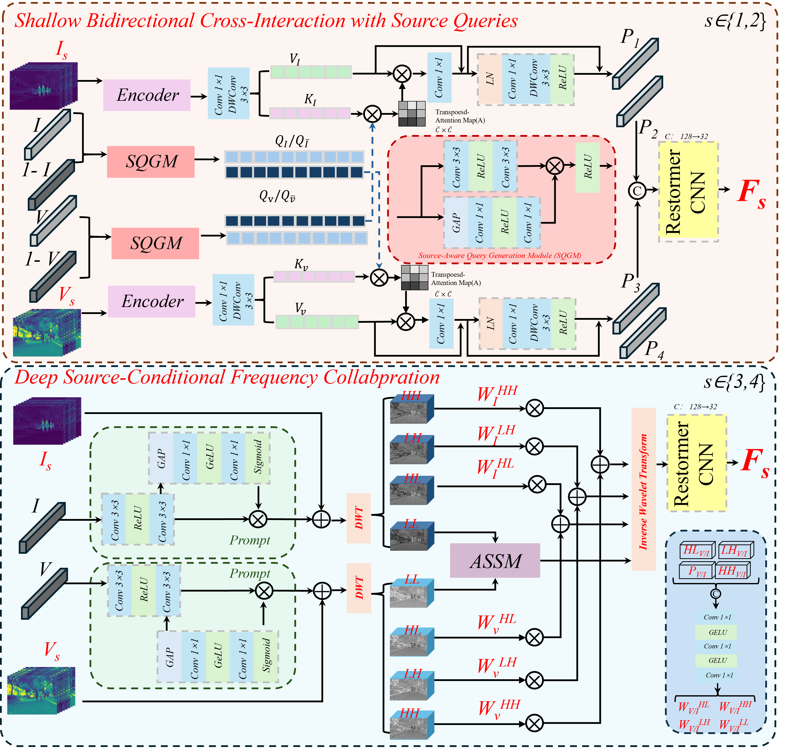
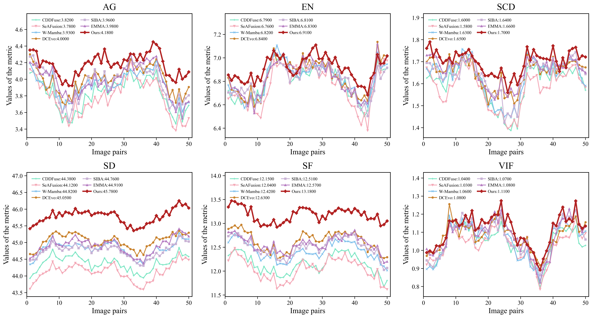
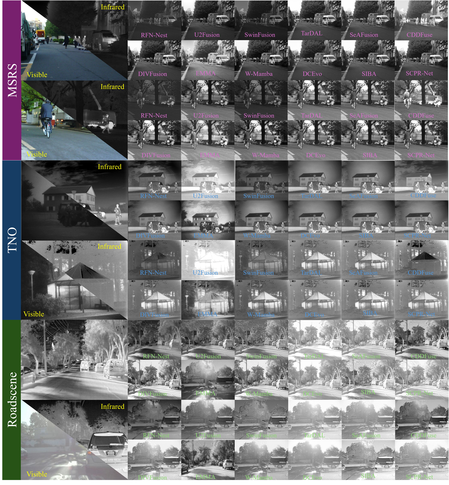
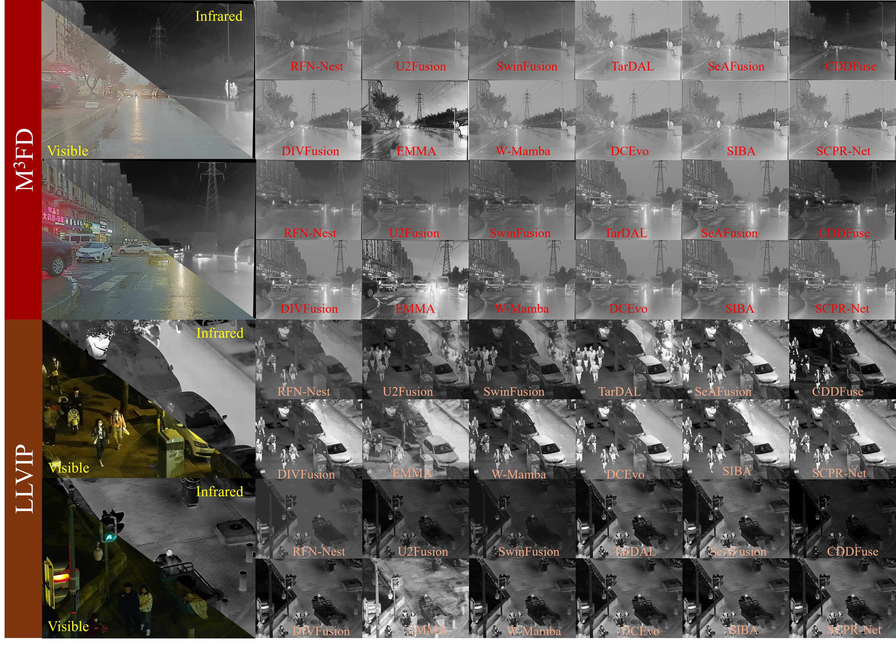
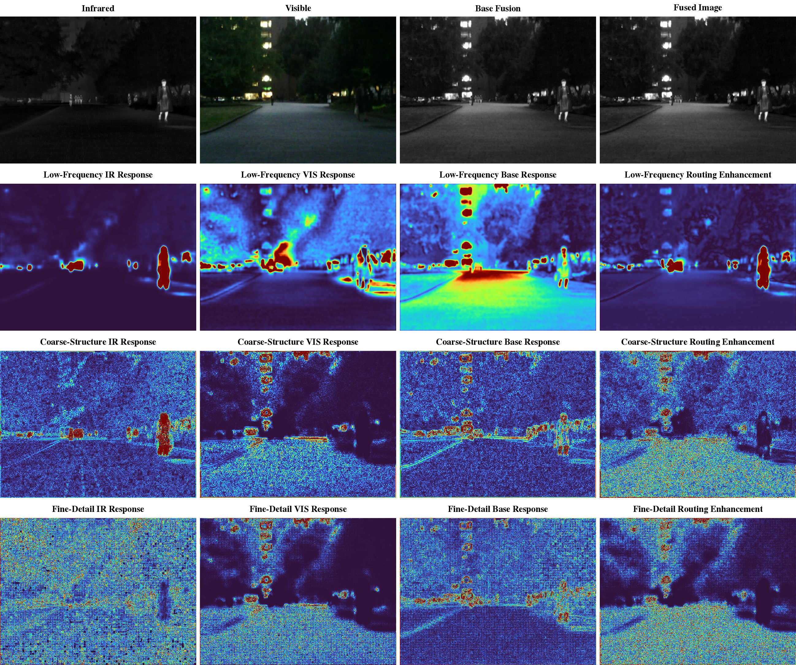
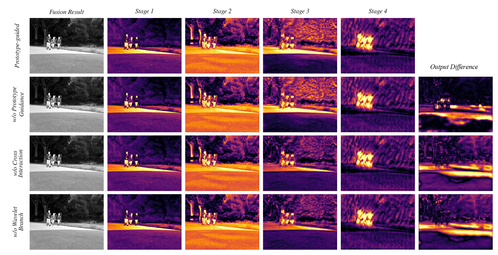
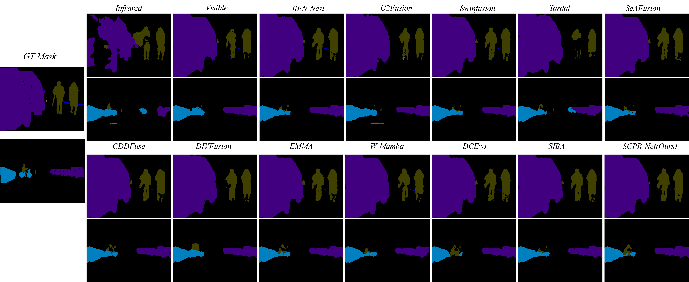
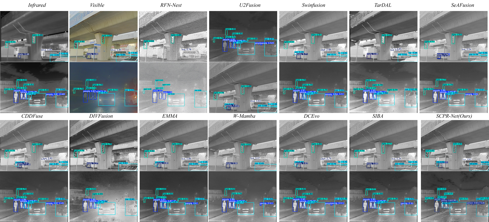

<div align="center">

# SCPR-Net

**Source-Conditioned Hierarchical Collaboration and Progressive Spatial-Frequency Reconstruction for Infrared and Visible Image Fusion**

[](environment.yml)
[](environment.yml)
[](environment.yml)
[](code/nets/scpr_net.py)
</div>

<p align="center">
  
</p>

## Architecture

<p align="center">
  
</p>

<p align="center">
  
</p>

## Quick Start

### 1. Environment

```bash
conda env create -f environment.yml
conda activate scpr-net
python -m pip install --no-build-isolation -r requirements-mamba.txt
```

### 2. Testing

#### Samples

```bash
python tools/infer_scpr.py --model outputs/checkpoints/SCPR-Net_best.ckpt
```

#### Benchmark

```bash
python tools/infer_scpr.py \
  --model outputs/checkpoints/SCPR-Net_best.ckpt \
  --ir-dir datasets/MSRS-main/test/ir \
  --vi-dir datasets/MSRS-main/test/vi \
  --output-dir outputs/MSRS
```

#### Evaluation

```bash
python code/repro/evaluate_metrics_parallel.py \
  --ir-dir datasets/MSRS-main/test/ir \
  --vi-dir datasets/MSRS-main/test/vi \
  --fused-dir outputs/MSRS \
  --output-dir outputs/metrics/MSRS
```

## Training

```bash
python tools/train_scpr.py \
  --data-root datasets/MSRS-main \
  --output-dir outputs/checkpoints
```

### Resume

```bash
python tools/train_scpr.py --data-root datasets/MSRS-main \
  --resume outputs/checkpoints/SCPR-Net_last.ckpt
```

### Check

```bash
python tools/check_scpr.py
```

## Datasets

The model is evaluated on five public infrared–visible benchmark datasets. All data are obtained from the official sources below, which include the standard test splits.

| Dataset | Modalities | Pairs | Evaluation | Official source |
|---|---|---|---|---|
| **MSRS** | IR + Visible | 1,444 | Quantitative, semantic segmentation | [github.com/Linfeng-Tang/MSRS](https://github.com/Linfeng-Tang/MSRS) |
| **TNO** | IR + Visible | multi-scene night-time | Quantitative | [figshare.com (TNO Image Fusion Dataset)](https://figshare.com/articles/dataset/TNO_Image_Fusion_Dataset/1008029) |
| **RoadScene** | IR + Visible | 221 | Qualitative | [github.com/hanna-xu/RoadScene](https://github.com/hanna-xu/RoadScene) |
| **M³FD** | IR + Visible | 4,200 | Qualitative, object detection | [github.com/JinyuanLiu-CV/TarDAL](https://github.com/JinyuanLiu-CV/TarDAL) |
| **LLVIP** | IR + Visible | 15,488 | Qualitative | [bupt-ai-cz.github.io/LLVIP](https://bupt-ai-cz.github.io/LLVIP/) |

## Experimental Results

### Quantitative comparison on MSRS

<p align="center">
  
</p>

### Qualitative comparison across five datasets

<p align="center">
  
</p>

<p align="center">
  
</p>

### Analysis

<p align="center">
  
</p>

<p align="center">
  
</p>

<p align="center">
  
</p>

<p align="center">
  
</p>

<p align="center">
  
</p>
